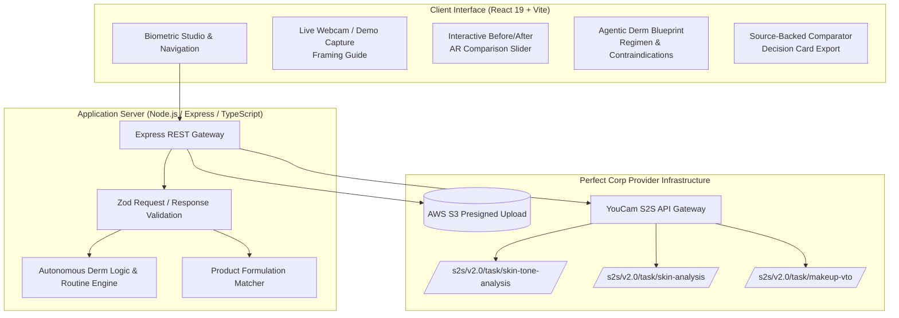

# BeautyLoop
> **Autonomous Dermatological AI & Dual Virtual Try-On Studio**  
> *Powered by Perfect Corp YouCam APIs (Clinical Skin AI, Colorimetry, and Dual AR Virtual Try-On)*

---

## Overview

Online beauty and skincare commerce suffers from a dual challenge: consumers cannot accurately test shade matches before purchasing, and formulation marketing frequently obscures whether ingredients suit an individual's skin barrier health. The result is consumer hesitation, product dissatisfaction, and extensive retail returns.

**BeautyLoop** addresses this challenge through an evidence-based decision workflow. By bridging clinical diagnostic biometrics with CIELAB colorimetry and dual augmented-reality try-on, BeautyLoop enables consumers to inspect their skin health, explore harmonized complexion pairings, verify source-backed product ingredients, and make confident purchasing decisions without marketing guesswork.

---

## Core System Architecture



---

## Key Capabilities

### 1. 10-Biomarker Clinical Skin Diagnostic Engine
Integrates directly with YouCam's Clinical Skin AI service to observe 10 dermatological cosmetic dimensions:
- **Pores**, **Texture**, **Acne**, **Wrinkles**, **Moisture**, **Oiliness**, **Redness**, **Radiance**, **Firmness**, and **Eye Bags**.
- Synthesizes findings into a dynamic **Skin Vitality Index (0–100)** calculated using weighted biomarker equilibrium, tracking both positive barrier factors (hydration, radiance, firmness) and regulatory factors (sebum, redness, pore dilation).

### 2. CIELAB Colorimetry & Undertone Analysis
- Computes facial skin color, natural lip pigment, eye color, and hair color.
- Projects color space data into CIE $L^*a^*b^*$ to evaluate facial temperature across **Warm**, **Cool**, **Neutral**, and **Olive** undertones.
- Employs CIE76 Delta-E Euclidean distance metrics to identify optimal foundation shade alignments from catalog formulations.

### 3. Dual AR Virtual Try-On Studio (Foundation + Lipstick)
- **Foundation Simulation**: Configurable color intensity, coverage depth, and skin glow parameters.
- **Lipstick Simulation**: Multi-texture support across **Matte**, **Glossy**, and **Shimmer** finishes.
- **Complete Harmonious Look**: Dispatches paired foundation and lip parameters in a single unified `/s2s/v2.0/task/makeup-vto` payload to minimize latency and credit consumption.
- **Interactive Before/After Slider**: Touch- and mouse-responsive split slider enabling sub-pixel comparison between baseline skin and simulated AR results.

### 4. Autonomous Agentic Derm Blueprint
- Evaluates biometric observations against dermatological formulation matrices to determine skin typology (e.g., *Dehydrated Oily Skin with Impaired Barrier*).
- Compiles tailored **4-step AM Defense** and **3-step PM Nocturnal Cellular Repair** routines with clinical rationale.
- **Contraindication Conflict Matrix**: Screens active formulations to flag incompatible active combinations (e.g., Retinol + Salicylic Acid / BHA conflicts or high-strength Vitamin C clashes).

### 5. Source-Backed Product Shortlist & Decision Card
- Cross-references catalog items with verified brand and retailer formulation records.
- Explicitly flags unverified claims (e.g., unconfirmed fungal acne safety or pregnancy suitability) rather than making assumptions.
- Generates a portable, copyable **Clinical Decision Card** capturing the selected product, retailer source receipts, observed price date, user criteria, and biometric scan results.

---

## Technical Stack

| Layer | Technologies |
| :--- | :--- |
| **Frontend** | React 19, TypeScript, Vite, TailwindCSS, Lucide Icons, Canvas API |
| **Backend** | Node.js, Express, TypeScript, Zod Schema Validation |
| **Integration** | Perfect Corp YouCam S2S REST APIs, AWS S3 Direct Upload Pipeline |
| **Monorepo** | pnpm workspaces, Turborepo-style build pipeline |

---

## Local Setup & Development

### Prerequisites
- Node.js `v20` or higher
- `pnpm` (`npm install -g pnpm`)

### 1. Clone the Repository
```bash
git clone https://github.com/Madhavan20906/BeautyLoop.git
cd BeautyLoop
```

### 2. Configure Environment Variables
Create a `.env` file in the root directory:
```env
YOUCAM_API_KEY=your_youcam_api_key_here
YOUCAM_BASE_URL=https://yce-api-01.makeupar.com
PORT=5000
```

### 3. Install Dependencies & Build
```bash
pnpm install
pnpm build
```

### 4. Start Development Server
```bash
pnpm start
```
Navigate to `http://localhost:5000` in your browser.

---

## Privacy & Data Handling

- **Consent-First Operation**: Biometric analysis and AR try-on tasks execute only following explicit user consent.
- **Ephemeral Asset Lifecycle**: Images are processed strictly for task execution and are not permanently retained.
- **Non-Diagnostic Scope**: BeautyLoop provides cosmetic formulation analysis and simulated visualization for retail exploration; it does not offer medical diagnoses or clinical prescriptions.

---

## License
This project is licensed under the MIT License - see the [LICENSE](LICENSE) file for details. Built for the YouCam API Skin AI & eCommerce Virtual Try-On Initiative.
